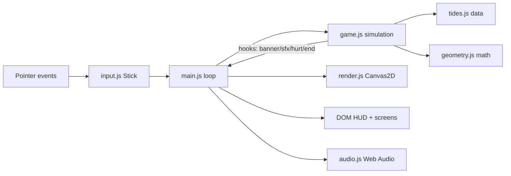

# Design Document

## Overview
A single-page Vite app. A fixed-timestep-free loop (`requestAnimationFrame`, dt clamped to 50 ms) calls `Game.update(dt, input)` then `Renderer.draw(game, t)`. DOM overlays handle HUD, controls and screens so they get crisp text, CSS animation and real `<button>` accessibility.

## Architecture

## Components and Interfaces
- `Stick(el, {deadzone})` exposes `x, y, mag, active, angle`.
- `Game(w, h, hooks)` - `start()`, `update(dt, {move, aim})`, `useFlare()`, `resize(w,h)`; `phase` in `title | intro | fight | ebb | paused | over | won`.
- `Renderer(canvas)` - `resize(w,h,dpr,game)`, `draw(game,t)`.
- `Sfx` - `unlock()`, `setMuted()`, `banish()`, `hurt()`, `flare()`, `wail()`.

## Data Models
- Keeper `{x, y, hp, inv, face}`; Beam `{on, angle}`; oil `0..1` with `dry` latch.
- Ghost `{type, x, y, hp, max, r, speed, hue, lit, age, seed, zig, boss, summon}`.
- Tide `{name, omen, spawn: {type: count}, interval}`.

## Lighting
A second offscreen canvas is filled with near-black, then `destination-out` radial gradients cut holes: tower glow, slow decorative lighthouse sweep, keeper aura, lantern cone, flare rings. Ghost bodies are drawn before the mask (alpha boosted by `lit`), ghost eyes and particles after it with `lighter` compositing so they glow through the dark.

## Error Handling
- Audio context is created lazily on first tap; missing Web Audio silently disables sound.
- Fullscreen / orientation lock are best-effort (`.catch(() => {})`).
- Visibility change pauses the run.

## Testing Strategy
- Unit: cone test incl. the +/-PI seam, ellipse clamp, oil drain/dry latch, damage and loss, flare limits, tide queue.
- Smoke: Playwright at 914x411 DPR 2.625 - title and gameplay screenshots, zero console errors, automated audit of 24 px margins, 44 px targets and 12 px fonts.
