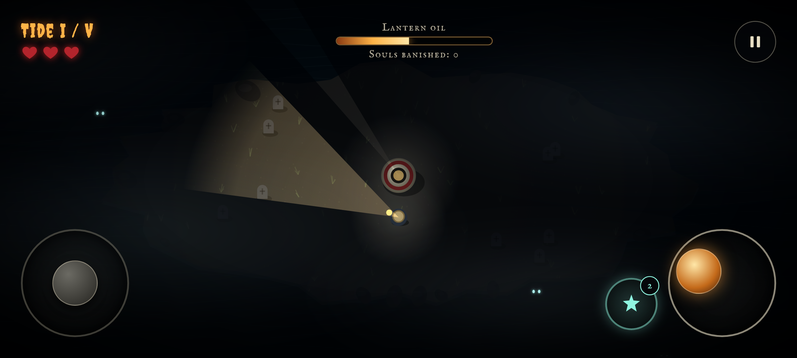
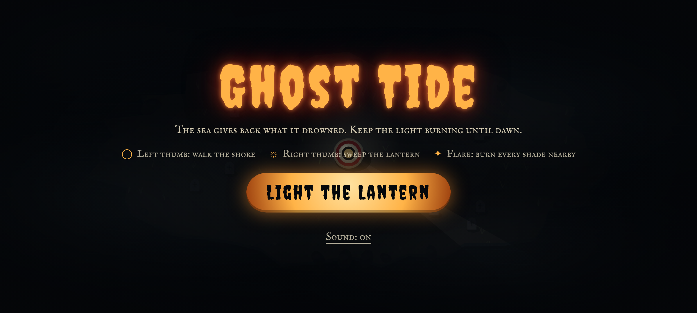

# Ghost Tide

> *The sea gives back what it drowned. Keep the light burning until dawn.*

A short, polished Halloween horror mini-game for **phones in landscape**. You are the last keeper of a lighthouse on a cursed island. Five tides of the drowned rise from the black water. Your only weapon is a lantern with a limited supply of oil.

Built for **Kiroween 2026** (category: **Costume Contest**).

## Play online
**Live demo (GitHub Pages):** https://sengmu.github.io/Ghost-Tide/ — open on a phone held sideways, with sound on.

Source: https://github.com/sengmu/Ghost-Tide




## Features
- **Lantern beam combat**: drag the right thumb-stick to sweep a cone of light. Ghosts in the cone are revealed, slowed to 30 % speed and banished. The lantern burns oil. If it runs dry it sputters out and won't relight until the oil is back to 25 %.
- **Darkness as the enemy**: the island is almost black. Ghost bodies only show inside light, but their eyes are always glowing at you.
- **Five escalating tides**:
  - Wisps.
  - Shades (slow and tanky).
  - Banshees (zig-zag movement).
  - The Drowned Keeper, a wraith boss with a health ring that summons wisps.
- **Flares**: two per tide. Each burns every ghost within 160 px.
- **Costume-grade horror UI**:
  - Flickering Creepster titles and IM Fell English captions.
  - Drifting fog, a vignette that pulses blood-red when you're hit, and screen shake.
  - SVG hearts and an ember oil gauge.
- **Procedural everything**:
  - The island, graves, sea and ghosts are drawn on Canvas2D.
  - Drone, wind, wails and banish chimes are synthesised with Web Audio.
  - There are no image or audio files.
- **Mobile-first rules enforced by an automated audit**:
  - Reference viewport 914x411 (DPR 2.625).
  - Safe margin of at least 24 px, also honouring `env(safe-area-inset-*)`.
  - Touch targets of at least 44 px and text of at least 12 px.
  - No keyboard or mouse prompts, and a rotate-your-phone screen in portrait.
- **Device behaviour**: pauses when the tab is hidden, respects `prefers-reduced-motion`, and supports haptics (`navigator.vibrate`) where available.

## Run it
```bash
npm install
npm run dev        # opens on http://localhost:5173 (also on your LAN via --host, so you can open it on a phone)
npm test           # Vitest unit tests (geometry, oil, damage, flares, tides)
npm run build      # production build into dist/
```
To smoke-test headlessly you need a local Chrome or Chromium:
```bash
npm run build && npx vite preview --port 4173 &
CHROME_PATH=/usr/bin/google-chrome npm run smoke   # writes docs/screenshot*.png, fails on console errors / layout-rule violations
```

## How to play
| Control | Action |
|---|---|
| Left thumb-stick | Walk the shore |
| Right thumb-stick (lantern) | Aim and burn the beam |
| Star button | Flare: burns every ghost nearby (2 per tide) |
| Pause (top-right) | Pause, resume, or abandon the run |

Survive all five tides to see the dawn. Three touches from the dead and the light goes out.

## Tech
Vite, vanilla ES modules and Canvas2D, with Web Audio for sound. Tests run on Vitest, and the smoke test uses Playwright (`playwright-core`). The production JS bundle is about 8 kB gzipped.

## How we used Kiro
> **Draft note (keep until a real Kiro IDE re-run):** the `.kiro` files below were authored outside Kiro IDE as the intended Kiroween workflow. They are **not** proof that Kiro generated this game. Open the repo in Kiro IDE, regenerate or refine the spec there, let the hooks actually fire, and then edit this section so that it only claims what really happened in Kiro.

Everything Kiro reads is in [`/.kiro`](.kiro). It is committed on purpose, and `.gitignore` does not exclude it.

### Specs (`.kiro/specs/ghost-tide/`)
- **`requirements.md`**: user stories with EARS acceptance criteria (`WHEN … THE SYSTEM SHALL …`, `WHILE …`, `WHERE …`) covering:
  - the landscape shell
  - movement
  - the lantern and oil
  - tides
  - damage, flares, winning and losing
  - atmosphere
- **`design.md`**: the architecture diagram, component interfaces, data models, the darkness-mask lighting technique and the testing strategy.
- **`tasks.md`**: the implementation plan. Each task is traced to requirement IDs (`_Requirements: 3.2_`).

The spec was most valuable for the oil "dry latch" rule (Req 3.4). Writing it as an EARS criterion exposed a bug: the beam stayed lit for one frame after the oil ran out. A unit test caught it and the bug was fixed.

### Steering (`.kiro/steering/`)
- **`product.md`**: the pillars and the hard mobile UI rules (24 px, 44 px, 12 px, landscape only, no keyboard or mouse prompts).
- **`tech.md`**: the stack, the module boundaries (the simulation never touches the DOM) and the bundle budget.
- **`structure.md`**: where each kind of code lives.

All three use `inclusion: always`, so every agent turn respects the mobile rules.

### Hooks (`.kiro/hooks/`, Kiro v1 JSON schema)
- **`test-on-save.json`**: `PostFileSave` on `src/(game|tides|geometry).js` or tests runs `npm test`.
- **`mobile-ui-guard.json`**: `PostFileSave` on `index.html`, `style.css` or `main.js` injects an agent prompt to re-check the mobile UI rules.
- **`build-on-stop.json`**: `Stop` runs `npm run build`, so a turn never ends with a broken build.

### Vibe coding vs. spec-driven
- **Spec-driven**: we used this for the simulation (`game.js`, `tides.js`, `geometry.js`). The rules are precise and testable, so EARS criteria turned directly into Vitest cases.
- **Vibe coding**: we used this for the "costume": fog, flicker timing, ghost silhouettes, the colour palette and the procedural audio. That work is about taste and quick visual iteration, and a spec would only have slowed it down.

### MCP
No MCP server is needed at runtime. During development, a browser or Playwright MCP server is the intended way to let the agent take 914x411 screenshots and read console errors. `scripts/screenshot.mjs` is the scripted equivalent and runs without MCP.

### Powers
No Kiro Powers are bundled in this repository.

## Credits and licenses
- Code: [MIT](LICENSE) © 2026 Ghost Tide contributors.
- Fonts: [Creepster](https://fonts.google.com/specimen/Creepster) and [IM Fell English SC](https://fonts.google.com/specimen/IM+Fell+English+SC), both under the SIL Open Font License 1.1, bundled via Fontsource.
- All art and audio are procedurally generated at runtime. No third-party assets or trademarks are used.

## License
MIT. See [LICENSE](LICENSE).
